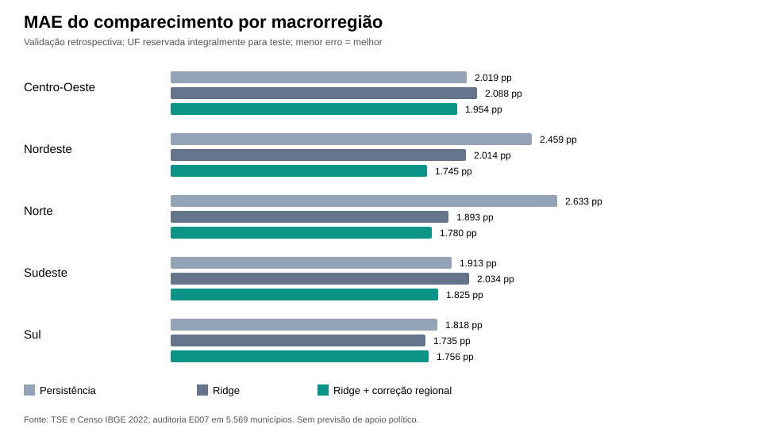

# E007 — Diagnóstico regional dos erros de comparecimento (17/10/2026)

**Status científico:** experimento exploratório retrospectivo concluído e validado pelo GitHub Actions. **Não** estima apoio a candidato, intenções individuais, bairros residenciais ou potencial de persuasão política.

## Dados oficiais e execução

- [GitHub Actions E007 — execução integral 39076094163](https://github.com/romulobrito/electoral-spatial-analysis/actions/runs/39076094163): sucesso, com 45 testes do repositório aprovados e Ruff sem erros.
- [Artefato de resultados e SVG](https://github.com/romulobrito/electoral-spatial-analysis/actions/runs/39076094163/artifacts/12117311026): JSON completo com 27 folds, recortes por região, população e densidade, figura SVG e relatório renderizado. Artefatos de Actions expiram em 14 dias.
- Dados: E005 TSE 2022/2026, E006 Censo IBGE 2022; checksums de entrada fixados em `residual_diagnostics.py`. A correspondência TSE–IBGE é verificada pelo SHA256 previamente auditado.
- **5.569** municípios analisados (5.570 geograficamente pareados, menos 1 caso Amazonas com denominador incompleto), todos os **27** estados/DF testados fora do treinamento em algum fold.

## Experimento

**Resposta:** mudança da taxa municipal de comparecimento entre primeiros turnos de 2022 e 2026, em pontos percentuais.

**Métodos:** (1) persistência: nenhuma mudança; (2) regressão ridge de E006, variáveis: taxa 2022, log população e log densidade IBGE 2022; (3) a mesma ridge, ajustada por intercepto da macrorregião calculado apenas com resíduos dos *estados de treinamento* da mesma macrorregião. Correção residual = soma dos resíduos do treino / (n_train_regional + **100**). Penalização ridge fixa em **10**.

| Modelo | MAE (pp) | RMSE (pp) |
| --- | ---: | ---: |
| Persistência histórica | 2,1355 | 2,8577 |
| Ridge (Censo) | 1,9567 | 2,5024 |
| Ridge + intercepto macrorregional (treino apenas) | **1,7915** | **2,2862** |

A diferença ridge − persistência no MAE foi **−0,1788 pp**. A diferença regional − ridge foi **−0,1652 pp** (redução relativa de 8,44% no MAE da ridge). A melhoria comparada à persistência foi **0,3440 pp**, calculada como diferença de MAE.

## Incerteza (400 reamostragens de estados, seed 2718)

| Diferença de MAE | Estimativa | Intervalo de sensibilidade 95% |
| --- | ---: | --- |
| Ridge − persistência | −0,1788 pp | [−0,4687; +0,0904] pp |
| Ridge regional − ridge | −0,1652 pp | [−0,3203; −0,0293] pp |

A faixa regional não cruza zero, **mas esta abordagem foi desenvolvida depois de observar a E006**: portanto, é **exploratória**, não uma evidência confirmatória independente. Com 27 clusters estaduais e regiões com número limitado de UFs, o intervalo não equivale a identificação causal nem garante generalização para outra eleição.

## Resíduos e heterogeneidade territorial

O componente entre estados explica cerca de **32,84%** da soma dos quadrados dos resíduos assinados da ridge observados em folds estaduais (medida descritiva de eta-quadrado). **Não se trata do índice de Moran nem de um teste formal de dependência espacial**, pois nenhuma matriz de vizinhança foi construída nesta etapa.

| Macrorregião | Municípios | MAE ridge | MAE regional | Viés assinado ridge (pp) |
| --- | ---: | ---: | ---: | ---: |
| Centro-Oeste | 467 | 2,0878 | 1,9540 | −1,2746 |
| Nordeste | 1.794 | 2,0138 | 1,7449 | +1,4092 |
| Norte | 449 | 1,8927 | 1,7801 | +0,9705 |
| Sudeste | 1.668 | 2,0342 | 1,8246 | −1,2760 |
| Sul | 1.191 | 1,7351 | 1,7558 | −0,4646 |

A correção melhora o MAE agrupado em quatro macrorregiões e aumenta-o ligeiramente no Sul. Os valores resumem **erros dos modelos**, não o desempenho de candidatos ou uma classificação de locais para ação eleitoral.

## Qualidade, limitações e próximos passos

- Excluir do teste a única observação AM `1302603` com denominador de 2022 pendente; nenhuma imputação.
- Auditoria fixa dos hashes E005/E006 e cruzamento TSE–IBGE. Não usar local de votação como sinônimo de bairro de residência.
- Separar diferença média de comparecimento, viés do modelo e autocorrelação espacial. Um teste de Moran exigiria malhas territoriais e uma matriz de vizinhança justificada.
- Censo 2022 pode ter sido publicado depois da eleição de 2022, portanto esta é uma avaliação **retrospectiva** e não uma simulação documentalmente comprovada de previsão disponível em 2022.
- Congelar hipóteses adicionais e testá-las num período futuro ou com uma segunda estratégia de validação independente; controlar efeitos de composição do eleitorado.
- A pesquisa trata de **participação eleitoral agregada**, sem inferir preferências de indivíduos ou escores de influência política por município/bairro.
